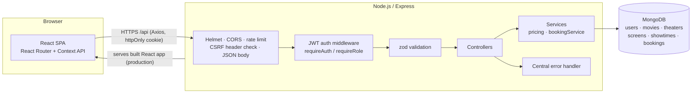
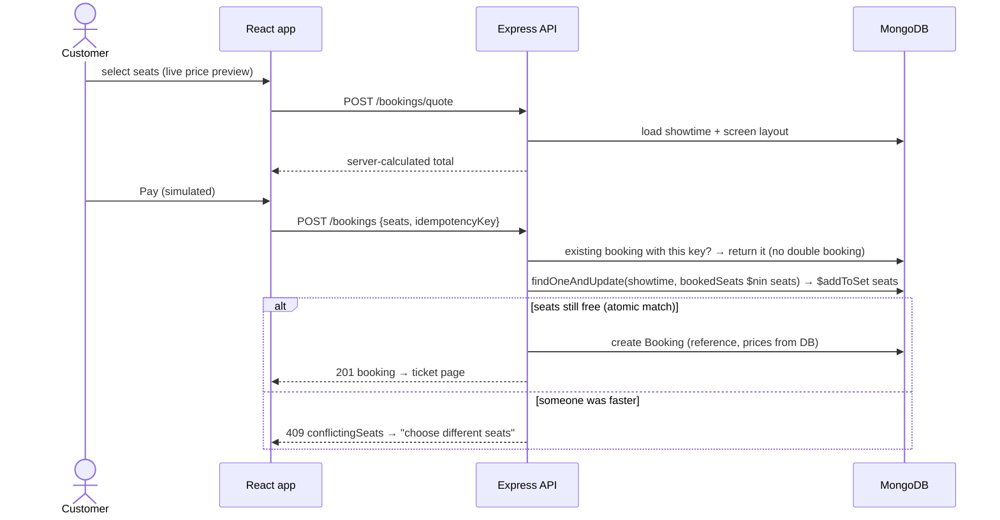

# 🎬 IMovies — Movie Ticket Booking System

> **Movie ticket booking made simple.** A full-stack MERN application to browse movies, choose a theater and showtime, pick seats on an interactive seat map and get a digital ticket. It includes a complete admin dashboard.

[](https://github.com/gracie-projects/imovies-movie-ticket-booking-system/actions/workflows/ci.yml)


| | |
| --- | --- |
| **GitHub repository** | <https://github.com/gracie-projects/imovies-movie-ticket-booking-system> |
| **Project demo video** | [docs/demo/IMovies_Project_Demo.webm](docs/demo/IMovies_Project_Demo.webm) (about 1.5 minutes, recorded automatically with Playwright from the running app) |
| **Live demo** | Not deployed yet. See [Deployment](#16-deployment) |
| **Demo customer** | `demo@imovies.test` / `Demo@12345` |
| **Demo admin (local only)** | `admin@imovies.test` / `Admin@12345` |


---

## Table of contents

1. [Overview](#1-overview)
2. [Problem statement & objectives](#2-problem-statement--objectives)
3. [Features](#3-features)
4. [Technology stack](#4-technology-stack)
5. [Architecture](#5-architecture)
6. [Database schema](#6-database-schema)
7. [Project structure](#7-project-structure)
8. [Prerequisites](#8-prerequisites)
9. [Installation](#9-installation)
10. [Environment setup](#10-environment-setup)
11. [Database initialization & seeding](#11-database-initialization--seeding)
12. [Start the backend](#12-start-the-backend)
13. [Start the frontend](#13-start-the-frontend)
14. [Testing](#14-testing)
15. [Recording the demo video](#15-recording-the-demo-video)
16. [Deployment](#16-deployment)
17. [Security notes](#17-security-notes)
18. [Demo accounts](#18-demo-accounts)
19. [Screenshots](#19-screenshots)
20. [Known limitations](#20-known-limitations)
21. [Troubleshooting](#21-troubleshooting)
22. [Links](#22-links)

---

## 1. Overview

IMovies is a cinema booking platform built as a third-year B.Tech (CSE – Artificial Intelligence) project.

- Customers browse **Now Showing** and **Coming Soon** movies, search and filter them, open a movie, choose a date, theater and showtime, and select seats on a live seat map.
- They pay through a **simulated checkout** and receive a **digital ticket** with a unique booking reference and a QR code.
- Administrators manage movies, theaters, screens and showtimes, and monitor bookings and revenue.

All data comes from a real **Express + MongoDB** REST API. The frontend has no hard-coded mock data.

## 2. Problem statement & objectives

Booking a cinema seat by phone or at the counter is slow, and customers can't see which seats are free. Small booking systems also often fail when two people try to buy the same seat at once. IMovies aims to:

- Give customers a fast, mobile-friendly way to find a show and choose exact seats.
- Guarantee **booking integrity**: the server calculates every price, a seat can never be sold twice, and customers can see only their own bookings.
- Give theater staff an admin dashboard to manage the schedule safely.
- Apply professional practices: layered architecture, validation, security middleware, automated tests, CI and reproducible demo data.

## 3. Features

### Customers
- Register, log in and log out with **JWT in an httpOnly cookie**. Expired sessions are detected and the user is sent back to login.
- Profile management: name, phone and password change.
- Movie catalog with posters, ratings, certificates, genres and languages.
- **Search by title**, **genre and language filters**, **Now Showing / Coming Soon** tabs and pagination.
- Movie details: description, duration, cast, director and release date.
- Showtimes for the next 7 days, grouped by **date → theater → time**, with seats left and starting price.
- **Interactive seat map** with classic and premium rows, aisles, and available, selected and booked states. It is keyboard accessible.
- **Live price calculation** with a convenience fee, re-confirmed by a **server quote** at checkout.
- **Simulated checkout** (UPI, card or wallet). No card details are ever collected.
- **Booking confirmation** with a digital ticket, unique reference (`IMV-XXXXXXXX`) and QR code.
- **My Bookings**: upcoming and past/cancelled history, plus cancellation (seats are released).
- Clear handling of seat conflicts: "Seat H6 was just booked by another customer".

### Admin dashboard
- Statistics: revenue, confirmed and cancelled bookings, tickets sold, customers, upcoming shows and top movies.
- Movie management: create, edit, archive and delete.
- Theater and screen management, including seat layout, premium rows and aisles.
- Showtime management with **overlap detection** (15-minute changeover) and automatic end times.
- Booking overview with search by reference and a status filter.
- **Safe handling of linked records**: movies, theaters, screens and showtimes with bookings can't be deleted, and booked shows can't be moved.

### Interface
- Dark cinematic theme (Bootstrap 5 + custom CSS), with responsive desktop and mobile layouts.
- Loading spinners, error alerts with retry, empty states and toast notifications.
- Accessible labels, a skip link, visible focus rings, `aria-pressed` seats and reduced-motion support.

## 4. Technology stack

| Layer | Technologies |
| --- | --- |
| Frontend | React 19, Vite 8, React Router 7, React-Bootstrap / Bootstrap 5, Bootstrap Icons, Axios, Context API, qrcode.react |
| Backend | Node.js 20+, Express 5, Mongoose 8, JSON Web Tokens, bcryptjs, zod validation, Helmet, express-rate-limit, CORS, cookie-parser, pino logging |
| Database | MongoDB (local, Atlas, or MongoDB Memory Server for development and tests) |
| Testing | Vitest + Supertest (API), Vitest + React Testing Library (UI), Playwright (end-to-end + video) |
| DevOps | GitHub Actions CI, Render Blueprint (`render.yaml`), MongoDB Atlas |

## 5. Architecture



**Layers (backend/src):** `routes` → `middleware` (auth, validation, security) → `controllers` (HTTP) → `services` (business rules: pricing, atomic booking) → `models` (Mongoose schemas and indexes). Errors from any layer go to one `errorHandler`, which returns a consistent JSON shape.

### Booking workflow and concurrency safety



Seats are reserved with **one conditional atomic update** on the showtime document. The update only matches if none of the requested seats is already in `bookedSeats`, so MongoDB guarantees that exactly one of several simultaneous requests wins. The backend test suite fires 8 parallel requests for the same seat and checks that exactly 1 succeeds. A client-generated **idempotency key** with a unique index `(user, idempotencyKey)` makes double clicks and retries safe. If creating the booking fails after the seats were reserved, the seats are released again.

### Authentication

1. Login/register → the server signs a JWT (`sub`, `role`, 2 h expiry) and sets it as an **httpOnly, SameSite=Lax cookie** (`Secure` in production).
2. JavaScript never sees the token, which protects it from theft through XSS.
3. `requireAuth` verifies the token **and reloads the user** on every request, so role changes and deleted accounts take effect immediately.
4. Every state-changing request must carry `X-Requested-With: XMLHttpRequest`. Browsers can't send that header cross-site without a CORS pre-flight, which only trusted origins pass. Together with SameSite cookies, this is the CSRF protection.
5. On a `401`, the React app clears the session and redirects to `/login?redirect=…`.

## 6. Database schema

```mermaid
erDiagram
  USER ||--o{ BOOKING : makes
  MOVIE ||--o{ SHOWTIME : "is shown in"
  THEATER ||--o{ SCREEN : has
  SCREEN ||--o{ SHOWTIME : hosts
  SHOWTIME ||--o{ BOOKING : "is booked by"

  USER { string name; string email UK; string passwordHash; string role "user|admin"; string phone }
  MOVIE { string title; string slug UK; string[] genres; string[] languages; number durationMins; string certificate; number rating; string director; string[] cast; date releaseDate; string status "now_showing|coming_soon|archived" }
  THEATER { string name UK; string city; string address; string[] amenities; bool isActive }
  SCREEN { ObjectId theater; string name; number rows; number seatsPerRow; string[] premiumRows; number[] aisleAfter }
  SHOWTIME { ObjectId movie; ObjectId theater; ObjectId screen; date startTime; date endTime; string language; string format; object prices; string[] bookedSeats; string status }
  BOOKING { string reference UK; ObjectId user; ObjectId showtime; object[] seats; number subtotal; number convenienceFee; number total; string paymentMethod; string status; string idempotencyKey }
```

**Indexes:** unique `email`, `slug`, `reference`, `(theater, name)` for screens, and `(user, idempotencyKey)` for bookings. Query indexes cover `(movie, startTime)`, `(screen, startTime)`, `genres`, `languages`, `status` and `(user, showStartTime)`.

## 7. Project structure

```text
imovies-movie-ticket-booking-system/
├── backend/                  Express REST API
│   ├── src/
│   │   ├── app.js            Express app (security middleware, routes, static frontend)
│   │   ├── server.js         Startup, DB connection, seeding, graceful shutdown
│   │   ├── config/           env.js (validated config), db.js (MongoDB / memory server)
│   │   ├── models/           User, Movie, Theater, Screen, Showtime, Booking
│   │   ├── middleware/       auth.js, security.js, validate.js, errorHandler.js
│   │   ├── validators/       zod request schemas
│   │   ├── controllers/      auth, movie, showtime, booking, admin
│   │   ├── services/         pricing.js, bookingService.js (atomic booking)
│   │   ├── routes/           index.js (all /api routes)
│   │   ├── seed/             seedData.js, seed.js (CLI)
│   │   └── utils/            ApiError, helpers, logger
│   └── tests/                Vitest + Supertest API tests
├── frontend/                 React + Vite client
│   ├── public/posters/       Original SVG artwork for the fictional movies
│   ├── scripts/              generate-posters.mjs
│   └── src/
│       ├── api/client.js     Axios instance + 401 handling
│       ├── context/          AuthContext, ToastContext
│       ├── components/       Navbar, MovieCard, SeatMap, TicketCard, ProtectedRoute, common UI
│       ├── pages/            Home, Movies, MovieDetails, SeatSelection, Checkout,
│       │                     BookingConfirmation, MyBookings, Auth, Profile, admin/*
│       ├── styles/app.css    Cinematic theme
│       └── test/             React Testing Library tests
├── e2e/                      Playwright tests + record-demo.js (video recorder)
├── docs/                     API.md, DEPLOYMENT.md, demo/IMovies_Project_Demo.webm
├── screenshots/              Real screenshots captured by the demo recorder
├── scripts/start-demo.mjs    One-command local demo server
├── .github/workflows/ci.yml  GitHub Actions pipeline
├── render.yaml               Render deployment blueprint
├── .env.example              All configuration options (no secrets)
└── package.json              Convenience scripts for the whole repository
```

## 8. Prerequisites

| Tool | Version | Notes |
| --- | --- | --- |
| Node.js | **20 or newer** (tested with 24 LTS) | <https://nodejs.org> includes npm |
| Git | any recent version | <https://git-scm.com> |
| MongoDB | *optional* | Not needed for development. The app falls back to an in-memory MongoDB, whose binary (~600 MB) is downloaded automatically on first run. Use local MongoDB 7+ or a free Atlas cluster for persistent data. |

Check the versions in **PowerShell** or **Command Prompt**:

```bash
node -v
npm -v
git --version
```

## 9. Installation

```bash
git clone https://github.com/gracie-projects/imovies-movie-ticket-booking-system.git
cd imovies-movie-ticket-booking-system
npm run install:all
```

`install:all` runs `npm install` in `backend/`, `frontend/` and `e2e/`. The commands are the same in PowerShell and Command Prompt. To install one part only, for example the backend:

```bash
cd backend
npm install
```

## 10. Environment setup

The app runs with **zero configuration** in development: it uses the in-memory database and a development-only JWT secret. To customise it, copy the example file.

**PowerShell** (from the repository root):

```powershell
Copy-Item .env.example backend\.env
```

**Command Prompt** (from the repository root):

```bat
copy .env.example backend\.env
```

Then edit `backend/.env`. The most important settings are:

| Variable | Example | Purpose |
| --- | --- | --- |
| `MONGODB_URI` | `memory`, `mongodb://127.0.0.1:27017/imovies`, or an Atlas URI | Database |
| `JWT_SECRET` | 48+ random characters | **Required in production** |
| `CLIENT_ORIGIN` | `http://localhost:5173` | CORS allow-list (comma separated) |
| `SERVE_FRONTEND` | `true` | Express serves `frontend/dist` |
| `SEED_IF_EMPTY` / `SEED_ON_START` | `true` | Load demo data on start |

Generate a secret with:

```bash
node -e "console.log(require('crypto').randomBytes(48).toString('hex'))"
```

The backend loads `.env` from the folder it is started in. Root `npm run …` scripts read `./.env`, and scripts run inside `backend/` read `backend/.env`.

## 11. Database initialization & seeding

| Mode | What to do |
| --- | --- |
| **In-memory (default)** | Nothing. The server seeds itself on every start. Data is lost when it stops. |
| **Local MongoDB** | Install MongoDB Community Server and start the service. Set `MONGODB_URI=mongodb://127.0.0.1:27017/imovies` in `backend/.env`, then run the seed command below. |
| **MongoDB Atlas** | Create a free cluster (see [docs/DEPLOYMENT.md](docs/DEPLOYMENT.md)). Put its URI in `MONGODB_URI`, then run the seed command below. |

Seed command (run in `backend/`):

```bash
npm run seed
```

The seed **wipes** the IMovies collections and loads 8 fictional movies (6 now showing and 2 coming soon), 2 theaters with 3 screens, 60 showtimes over the next 5 days, and the two demo accounts. In production it refuses to run unless you pass `-- --force` and set `SEED_ADMIN_PASSWORD`.

## 12. Start the backend

Run in `backend/`:

```bash
npm run dev
```

The API runs on <http://localhost:5000>. Check it at <http://localhost:5000/api/health/ready>, which should return `{"status":"ready","database":"connected"}`. Use `npm start` instead of `npm run dev` to run without auto-restart.

## 13. Start the frontend

In a **second terminal**, run in `frontend/`:

```bash
npm run dev
```

Open <http://localhost:5173>. Vite proxies `/api` to `http://localhost:5000`, so the auth cookie works without any CORS setup.

### One-command demo (production build)

Run from the repository root:

```bash
npm run start:demo
```

This builds the React app and serves **both** the app and the API at <http://localhost:5000>, using a freshly seeded in-memory database.

## 14. Testing

| Suite | Command | Working directory | What it covers |
| --- | --- | --- | --- |
| Backend (40 tests) | `npm test` | `backend/` | Registration, login, validation, CSRF, roles, catalog search and filters, server pricing, seat conflicts, an **8-way concurrent race**, idempotent duplicate submissions, ownership, cancellation, admin CRUD, safe deletion, schedule auto-fill |
| Frontend (25 tests) | `npm test` | `frontend/` | Catalog loading, filters, search, empty and error states, login/register validation, safe redirects, protected and admin routes, seat selection, live price, keyboard use, checkout, conflict UI, ticket view |
| Lint | `npm run lint` | `frontend/` | ESLint (React hooks rules) |
| End-to-end (6 tests) | `npx playwright install chromium` once, then `npm test` | `e2e/` | Full booking journey, two-customer seat conflict, cancellation, protected routes, admin permissions, showtime management with overlap rejection |

The end-to-end suite builds the frontend and starts its own server on port **5055** with a fresh in-memory database, so it never touches real data. Results from the last local run (Windows 11, Node 24): **backend 40/40 passed, frontend 25/25 passed, ESLint clean, Playwright 6/6 passed.**

To run both unit suites from the repository root:

```bash
npm test
```

## 15. Recording the demo video

1. From the repository root, start the app with `npm run start:demo`.
2. From `e2e/`, in a second terminal, run `npm run record-demo`. Set `DEMO_HEADED=true` first to watch the recording live.

The script ([`e2e/record-demo.js`](e2e/record-demo.js)):
- checks that the app is reachable, then drives the **real UI** in Chromium with on-screen captions;
- asserts every step, using the seeded demo account and only seats the server reports as available, so repeated runs never conflict;
- saves the video to `e2e/output/demo/IMovies_Project_Demo.webm`, screenshots to `screenshots/`, and a step log to `e2e/output/demo/demo-log.txt`;
- on failure, keeps `failure.png`, `failed-run.webm` and the log.

The committed copy of the video is [`docs/demo/IMovies_Project_Demo.webm`](docs/demo/IMovies_Project_Demo.webm). Play it in Chrome, Edge, Firefox or VLC. On Windows, drag the file into a browser tab if the Films & TV app can't open `.webm`.

The storyline is: home → catalog → genre filter and search → movie details → date, theater and showtime → seat map → seat selection → live price → login redirect → simulated checkout → confirmation and ticket → My Bookings → seats now booked → admin overview, movies, theaters, showtimes and bookings.

## 16. Deployment

IMovies deploys as a **single Render web service** (API + React app) backed by a **MongoDB Atlas** free cluster. The blueprint is in [`render.yaml`](render.yaml), and step-by-step instructions are in **[docs/DEPLOYMENT.md](docs/DEPLOYMENT.md)**.

Summary:
1. Create an Atlas M0 cluster and database user, then copy the connection string.
2. On Render, choose **New → Blueprint**, select this repository, then enter `MONGODB_URI`, `CLIENT_ORIGIN`, `SEED_ADMIN_PASSWORD` and `SEED_DEMO_PASSWORD`.
3. Verify with `https://<app>.onrender.com/api/health/ready`.

Free Render services sleep after about 15 minutes idle, and the first request then takes **30–60 s**. `SEED_IF_EMPTY` seeds the database only on the very first start, and `SCHEDULE_AUTOFILL` keeps showtimes available for the next 5 days without ever deleting bookings.

## 17. Security notes

- Passwords are hashed with **bcrypt** (cost 12) and never returned by the API (`select: false` plus a JSON transform).
- Sessions use a **JWT in an httpOnly cookie** (SameSite=Lax, Secure in production) with a 2-hour expiry. Tampered or expired tokens return `401`.
- Role-based authorization (`user`, `admin`) is checked on the server for every admin route. Public sign-up always creates a `user`.
- **CSRF**: a custom header is required on all state-changing requests, together with SameSite cookies and a strict CORS allow-list.
- **Helmet** sets security headers, including a Content Security Policy.
- **Rate limiting**: 20 failed logins per 15 minutes, and 300 API requests per minute per IP.
- Every request body and query is validated with **zod**. Unknown fields are stripped, and regex input is escaped in search.
- **Booking integrity**: prices come only from the database, seats are reserved atomically, and ownership is checked. Other customers' bookings return `404`, so booking IDs aren't revealed.
- Logs never include passwords, cookies or authorization headers (pino redaction). Production refuses to start without a strong `JWT_SECRET` and a persistent database.
- No real payment data is collected. Checkout is clearly labelled as simulated.
- Secrets live only in `.env` files (ignored by git) or the hosting provider's settings.

## 18. Demo accounts

| Role | Email | Password | Notes |
| --- | --- | --- | --- |
| Customer | `demo@imovies.test` | `Demo@12345` | Seeded by default |
| Admin | `admin@imovies.test` | `Admin@12345` | **Local/demo only**. A production seed requires your own `SEED_ADMIN_PASSWORD`. |

You can also register any new customer account. The `.test` domain is reserved, so these addresses never receive email.

## 19. Screenshots

All screenshots are captured automatically from the running application by `e2e/record-demo.js`.

| | |
| --- | --- |
|  **Movie catalog** |  **Search and filters** |
|  **Movie details** |  **Theater, date and showtime** |
|  **Seat map and live price** |  **Simulated checkout** |
|  **Confirmation and digital ticket** |  **My Bookings** |
|  **Admin overview** |  **Showtime management** |
|  **Movie management** |  **Booking overview** |

## 20. Known limitations

- **Payments are simulated.** There is no payment gateway, and refunds on cancellation are simulated too.
- **No temporary seat holds.** Seats are reserved at the moment of payment, not while a customer is on the checkout page. A conflict is detected and explained if another customer pays first.
- **In-memory database** (`MONGODB_URI=memory`) is for development and tests only. All data is lost on restart, and it runs as a single process. Use local MongoDB or Atlas for anything persistent. The atomic seat reservation works the same in all modes.
- Showtimes are listed for the next 7 days. Seeded show times use Indian Standard Time (`SEED_UTC_OFFSET_MINUTES=330`) and are shown in the viewer's local time zone.
- Movie artwork is generated SVG for fictional films. Admins can point `posterUrl` to any image URL.
- No email or SMS notifications, and no password-reset email flow.
- Rate limits are stored in memory per server instance.

## 21. Troubleshooting

| Problem | Fix |
| --- | --- |
| `EADDRINUSE: address already in use :::5000` | Another program uses the port. Stop it, or set `PORT=5001` in `backend/.env` and start Vite with `$env:VITE_PROXY_TARGET="http://localhost:5001"; npm run dev` (PowerShell) or `set VITE_PROXY_TARGET=http://localhost:5001 && npm run dev` (Command Prompt). |
| Port 5173 in use | Close the other Vite instance, or run `npm run dev -- --port 5174`. |
| `MongooseServerSelectionError` / `ECONNREFUSED 127.0.0.1:27017` | Local MongoDB isn't running. Start the **MongoDB** Windows service, or set `MONGODB_URI=memory`. For Atlas, check the user, password and Network Access IP list. |
| First start hangs at "Downloading MongoDB" | The in-memory server downloads a MongoDB binary (~600 MB) once. Wait for it to finish, or use a local or Atlas database. |
| `Invalid environment configuration` | Production needs `JWT_SECRET` (32+ characters) and a real `MONGODB_URI`. `COOKIE_SAMESITE=none` also needs `COOKIE_SECURE=true`. |
| CORS errors or you are logged out immediately | Add your frontend URL to `CLIENT_ORIGIN`. If the frontend and API are on different domains, use HTTPS with `COOKIE_SAMESITE=none` and `COOKIE_SECURE=true`. |
| `403 Missing CSRF header` from Postman or curl | Add the header `X-Requested-With: XMLHttpRequest`. |
| `npx playwright test` fails with "Executable doesn't exist" | Run `npx playwright install chromium` in `e2e/`. |
| PowerShell blocks `npm` scripts (`running scripts is disabled`) | Run `Set-ExecutionPolicy -Scope CurrentUser RemoteSigned`, or use Command Prompt. |

## 22. Links

- **GitHub repository:** <https://github.com/gracie-projects/imovies-movie-ticket-booking-system>
- **Live application:** not deployed yet. Follow [docs/DEPLOYMENT.md](docs/DEPLOYMENT.md).
- **Project demo video:** [docs/demo/IMovies_Project_Demo.webm](docs/demo/IMovies_Project_Demo.webm)
- **API reference:** [docs/API.md](docs/API.md)

---

Made for the SkillWallet *Full Stack Development (MERN)* program. All movie titles, people and artwork are fictional.
