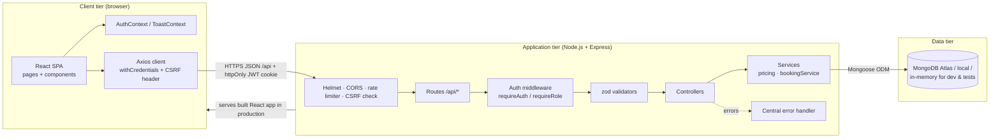
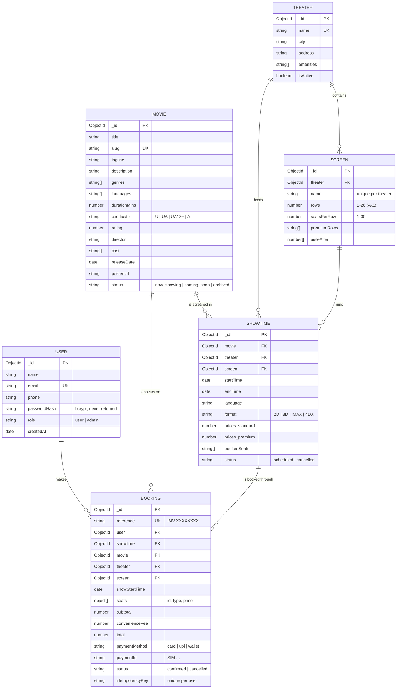
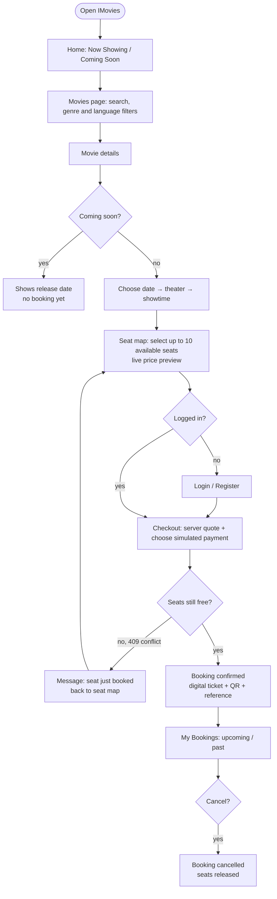
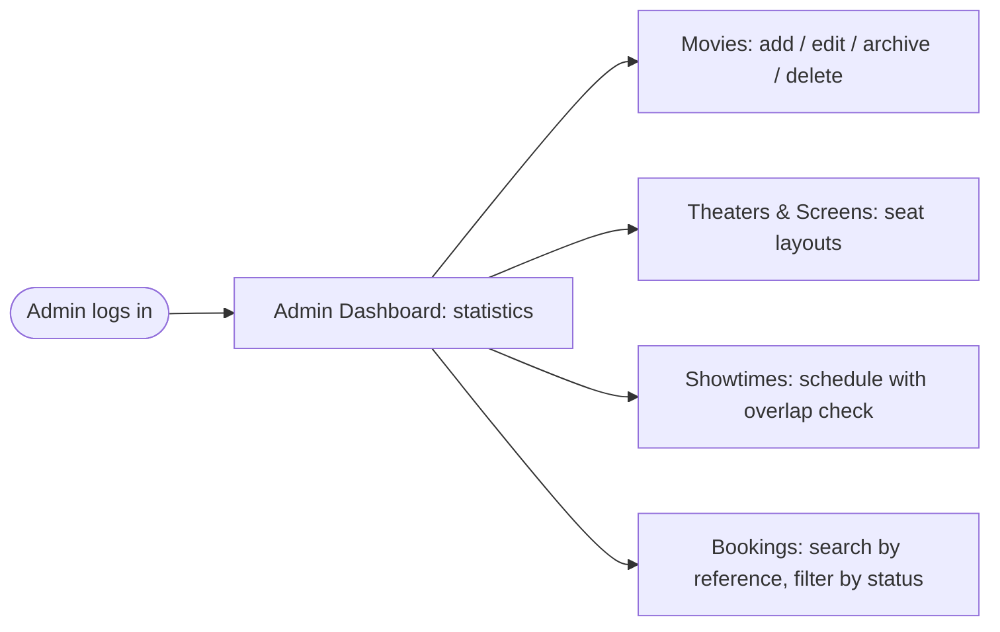
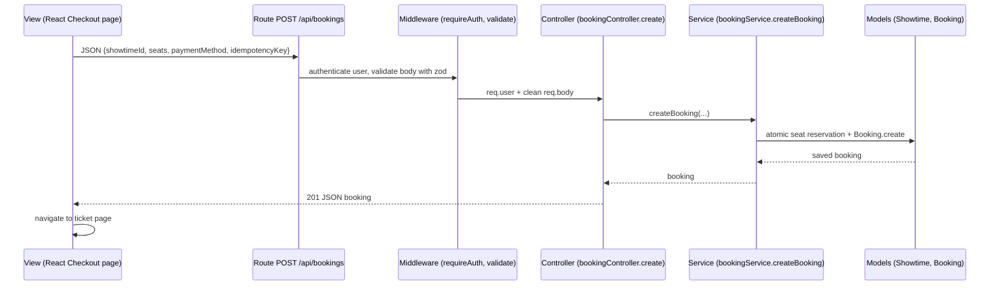

# Epic 1 — Project Architecture

[← Task index](README.md)

---

## 1. Technical Architecture

IMovies is a **three-tier MERN application**:

| Tier | Technology | Responsibility |
| --- | --- | --- |
| Presentation | React 19 + Vite, React Router 7, React-Bootstrap 5, Axios | Pages, seat map, forms, client-side validation, session state (Context API) |
| Application | Node.js 20+, Express 5 | REST API, authentication, authorization, validation, pricing and booking rules |
| Data | MongoDB with Mongoose 8 | Users, movies, theaters, screens, showtimes, bookings, indexes and schema validation |

**Key architectural decisions**

| Decision | Reason |
| --- | --- |
| **Single deployable service.** Express serves the API and the built React app. | One URL, no cross-site cookies, simpler hosting on Render. |
| **JWT in an httpOnly cookie** instead of localStorage | JavaScript can't read the token, which protects it from XSS theft. |
| **Layered backend:** routes → middleware → controllers → services → models | Each layer has one job, which makes the code easy to test and explain. |
| **Atomic seat reservation** in MongoDB (`findOneAndUpdate` with `$nin`) | Two customers can never book the same seat, even at the same millisecond. |
| **Server-side pricing** | The client only previews prices; the database is the source of truth. |
| **In-memory MongoDB for development and tests** | Anyone can run the project without installing MongoDB. |

**Technology stack**

- **Frontend:** React, Vite, React Router, React-Bootstrap/Bootstrap 5, Bootstrap Icons, Axios, qrcode.react.
- **Backend:** Express, Mongoose, jsonwebtoken, bcryptjs, zod, Helmet, express-rate-limit, cors, cookie-parser, pino.
- **Testing:** Vitest, Supertest, React Testing Library, Playwright.
- **DevOps:** Git/GitHub, GitHub Actions CI, Render, MongoDB Atlas.

---

## 2. ER-Diagram

**Relationships explained**

- A **User** can make many **Bookings**. Each booking belongs to exactly one user.
- A **Theater** has many **Screens**. Each screen defines its own seat layout and premium rows.
- A **Showtime** links one **Movie** to one **Screen** (and its Theater) at a start time, with prices for standard and premium seats.
- A **Booking** reserves one or more seats in one showtime. The booking stores a copy of the seat prices so later price changes don't affect it.
- `Showtime.bookedSeats` is the list of seats that are taken. It is changed only with atomic updates.

**Indexes:** unique `User.email`, `Movie.slug`, `Booking.reference`, `Screen(theater, name)` and `Booking(user, idempotencyKey)`. Query indexes cover `Showtime(movie, startTime)`, `Showtime(screen, startTime)`, `Movie.genres`, `Movie.languages`, `Movie.status` and `Booking(user, showStartTime)`.

---

## 3. Features

### Guest (not logged in)
- Browse **Now Showing** and **Coming Soon** movies with posters, ratings and certificates.
- **Search** by title and **filter** by genre, language and release status, with pagination.
- View movie details: description, duration, cast, director, release date and languages.
- See showtimes for the next 7 days grouped by **date → theater → time**, with seats left and prices.
- Open the **interactive seat map** and see a live price.
- Register or log in. After logging in, the app returns to the page you were on.

### Customer (logged in)
- Select up to 10 seats, choosing **classic or premium**.
- **Checkout:** the server calculates the price, and payment is simulated (UPI, card or wallet). No real payment details are collected.
- **Booking confirmation** with a digital ticket, unique reference and QR code.
- **My Bookings:** upcoming and past/cancelled bookings.
- **Cancel** an upcoming booking, which releases the seats.
- **Profile:** update name and phone, and change password.
- Clear messages when a seat was just booked by someone else.

### Admin
- **Dashboard statistics:** revenue, tickets sold, confirmed and cancelled bookings, customers, upcoming shows, recent bookings and top movies.
- **Movies:** create, edit, archive and delete. Deletion is blocked if the movie has booking history.
- **Theaters and screens:** create and edit theaters and seat layouts (rows, seats per row, premium rows, aisles).
- **Showtimes:** create, edit and delete. The server rejects overlapping shows on the same screen (15-minute changeover) and blocks moving shows that already have bookings.
- **Bookings:** list every booking, filter by status and search by reference.

### Non-functional features
- Security: bcrypt password hashing, httpOnly JWT cookie, role checks, CSRF header check, Helmet, rate limiting and input validation.
- Reliability: atomic seat booking, idempotent checkout, central error handling, health and readiness endpoints, graceful shutdown.
- Usability: responsive dark cinematic theme, loading, empty and error states, toast notifications, keyboard-accessible seat map.
- Quality: 40 backend tests, 25 frontend tests, 6 Playwright end-to-end tests, and GitHub Actions CI.

---

## 4. Roles and Responsibilities

### System roles (inside the application)

| Role | How the role is obtained | Allowed actions | Enforced by |
| --- | --- | --- | --- |
| **Guest** | Not logged in | Browse catalog, search and filter, view details, showtimes and seat map, register, log in | Public routes |
| **Customer** (`user`) | Self-registration (`/register`). Public sign-up can **never** create an admin. | Everything a guest can do, plus book seats, pay (simulated), view and cancel **own** bookings, edit profile | `requireAuth` middleware; ownership checks in [bookingController.js](../../backend/src/controllers/bookingController.js) |
| **Admin** (`admin`) | Created by the seed script (`admin@imovies.test`) | Everything, plus manage movies, theaters, screens and showtimes, view all bookings and statistics | `requireRole('admin')` on every `/api/admin/*` route in [routes/index.js](../../backend/src/routes/index.js); the `ProtectedRoute role="admin"` page guard |

Security rules:
- A customer requesting someone else's booking gets **404**, so booking IDs aren't revealed.
- Admin APIs return **401** without login and **403** for customers.
- The role is re-read from the database on every request, so a changed role takes effect immediately.

### Project responsibilities (individual project)

| Responsibility area | Work done |
| --- | --- |
| Requirement analysis | Defined user stories for guest, customer and admin; listed booking integrity rules |
| System design | Architecture, ER diagram, API design ([docs/API.md](../API.md)) |
| Backend development | Express API, authentication, validation, booking service, admin APIs |
| Database development | Mongoose schemas, indexes, seed data, Atlas configuration |
| Frontend development | React pages, components, seat map, admin dashboard, styling |
| Testing and QA | Unit, integration and end-to-end tests; CI pipeline |
| Deployment and documentation | Render + Atlas deployment, README, demo video, screenshots |

---

## 5. User Flow

### Customer booking flow

### Admin flow

### Session flow
1. Login sets an httpOnly cookie that is valid for 2 hours.
2. On page refresh, `AuthContext` calls `GET /api/auth/me` to restore the session.
3. If any request returns **401** (session expired), the app shows "Your session has expired" and redirects to `/login?redirect=<current page>`.

---

## 6. MVC Pattern

IMovies follows **MVC** on the server, and React provides the **View**:

| MVC part | In IMovies | Files |
| --- | --- | --- |
| **Model** | Mongoose schemas: data shape, validation rules, indexes, helper methods (`setPassword`, `verifyPassword`, `allSeatIds`, `seatType`) | [backend/src/models/](../../backend/src/models) |
| **View** | React single-page app. It renders JSON from the API as pages. Express returns JSON only, never HTML templates. | [frontend/src/pages/](../../frontend/src/pages), [frontend/src/components/](../../frontend/src/components) |
| **Controller** | Express controller functions: read the request, call models and services, send the response | [backend/src/controllers/](../../backend/src/controllers) |
| Routes | Map URL + HTTP method → middleware → controller | [backend/src/routes/index.js](../../backend/src/routes/index.js) |
| Services | Business logic shared by controllers: pricing and atomic booking | [backend/src/services/](../../backend/src/services) |
| Middleware | Cross-cutting concerns: authentication, roles, validation, CSRF, errors | [backend/src/middleware/](../../backend/src/middleware) |

**Why this separation helps:** controllers stay short, business rules live in one place (services) and are unit-tested, and the same models are reused by the seed script, the API and the tests.
