# Epic 6 — Project Execution

[← Task index](README.md)

---

## 17. Steps for Project Execution

### Prerequisites
- **Node.js 20 or newer** (<https://nodejs.org>) and **Git** (<https://git-scm.com>).
- MongoDB is **optional**: by default the app uses an in-memory database.

### A. Get the code and install dependencies

```bash
git clone https://github.com/gracie-projects/imovies-movie-ticket-booking-system.git
cd imovies-movie-ticket-booking-system
npm run install:all
```

### B. Quick start: one command (recommended for evaluation)

Run from the repository root:

```bash
npm run start:demo
```

This builds the React app and starts **one server** with the app and the API at **<http://localhost:5000>**, using a freshly seeded in-memory database.

### C. Development mode (two terminals)

Terminal 1, in `backend/`:

```bash
npm run dev
```

Terminal 2, in `frontend/`:

```bash
npm run dev
```

Open **<http://localhost:5173>**. The API runs on port 5000, and Vite forwards `/api` requests to it.

### D. Use a persistent database (optional)
1. Copy `.env.example` to `backend\.env`:
   - PowerShell: `Copy-Item .env.example backend\.env`
   - Command Prompt: `copy .env.example backend\.env`
2. Set `MONGODB_URI` to a local MongoDB or Atlas connection string.
3. In `backend/`, run `npm run seed`, then `npm run dev`.

### E. Log in and try it

| Role | Email | Password |
| --- | --- | --- |
| Customer | `demo@imovies.test` | `Demo@12345` |
| Admin (local) | `admin@imovies.test` | `Admin@12345` |

Customer walkthrough: **Movies → pick a movie → choose date and showtime → select seats → Proceed to checkout → Pay → ticket → My Bookings**.
Admin walkthrough: log in as admin → **Admin** in the navbar → Overview, Movies, Theaters & Screens, Showtimes, Bookings.

### F. Run the tests

| Suite | Command | Working directory | Last result |
| --- | --- | --- | --- |
| Backend API | `npm test` | `backend/` | 40 passed |
| Frontend UI | `npm test` | `frontend/` | 25 passed |
| Lint | `npm run lint` | `frontend/` | no errors |
| End-to-end | `npx playwright install chromium` (first time only), then `npm test` | `e2e/` | 6 passed |

The same tests run automatically on every push in **GitHub Actions**: <https://github.com/gracie-projects/imovies-movie-ticket-booking-system/actions>

### G. Common problems

| Problem | Fix |
| --- | --- |
| `EADDRINUSE :5000` | Another program uses the port. Close it, or set `PORT=5001` in `backend/.env`. |
| First start shows "Downloading MongoDB" | One-time download of about 600 MB for the in-memory database. Wait for it to finish. |
| `MongooseServerSelectionError` | Local MongoDB isn't running, or the Atlas user, password or Network Access is wrong. |
| PowerShell says "running scripts is disabled" | Run `Set-ExecutionPolicy -Scope CurrentUser RemoteSigned`, or use Command Prompt. |

---

## 18. Output Screenshots

Screenshots are captured automatically from the running application by [e2e/record-demo.js](../../e2e/record-demo.js) and saved in [`screenshots/`](../../screenshots).

### Customer journey

| Step | Screenshot |
| --- | --- |
| 1. Home page with featured movie | 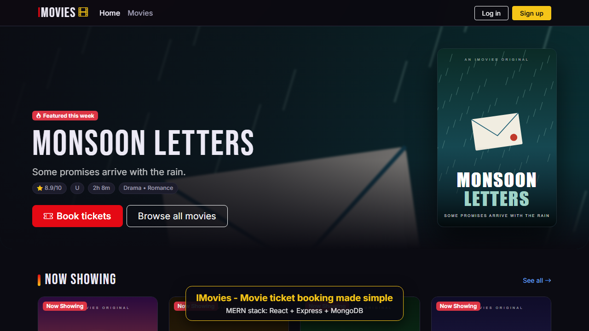 |
| 2. Movie catalog | 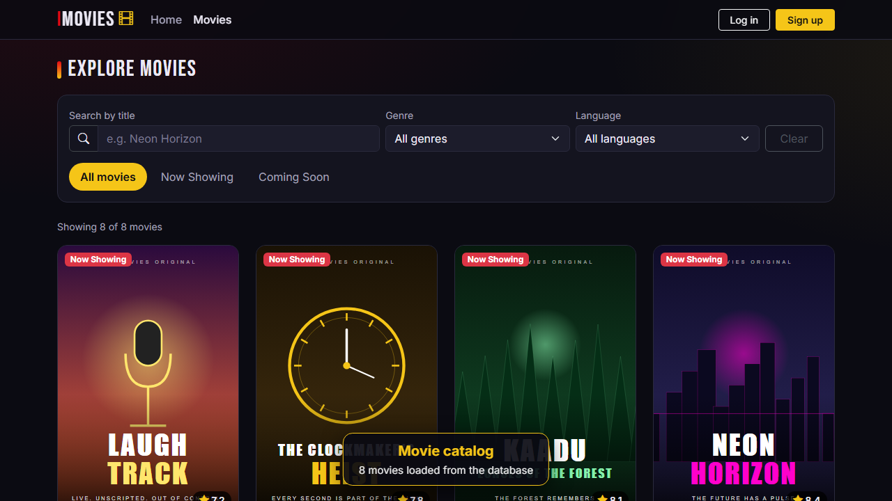 |
| 3. Search and filters | 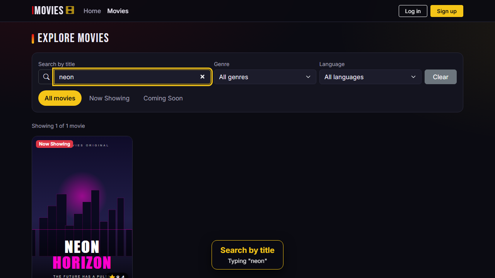 |
| 4. Movie details | 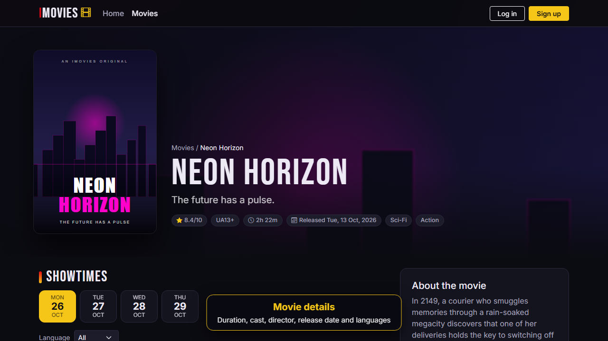 |
| 5. Date, theater and showtime selection | 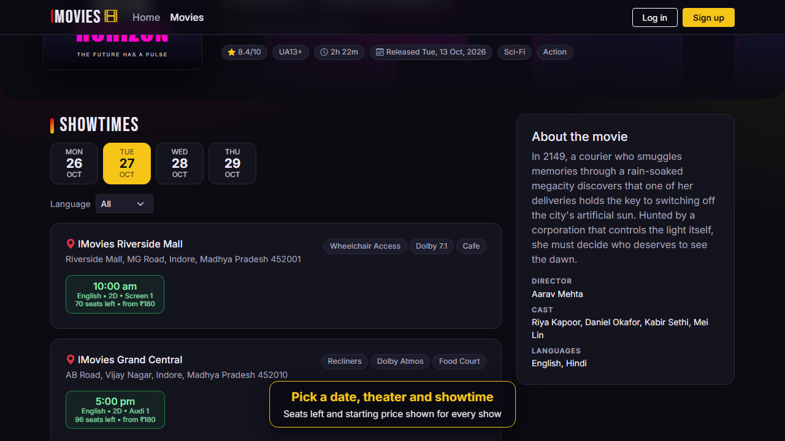 |
| 6. Seat map with live price | 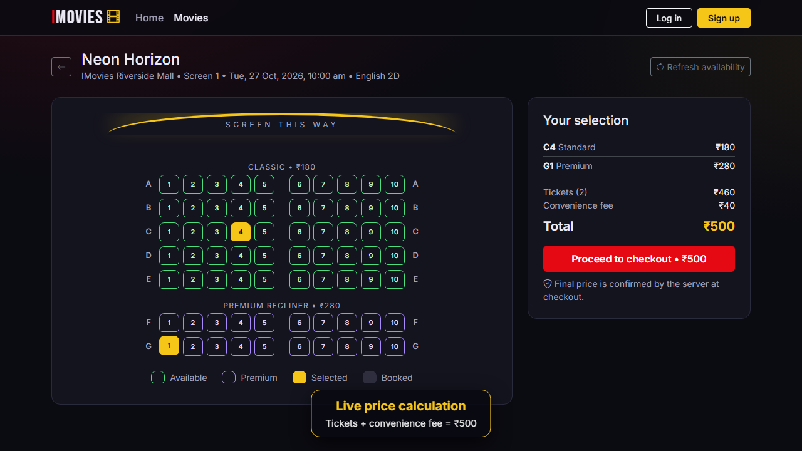 |
| 7. Login (protected checkout) | 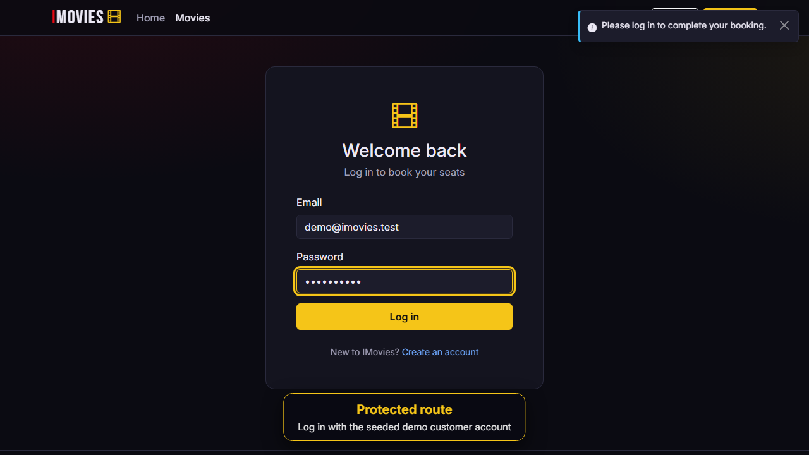 |
| 8. Simulated checkout with server price | 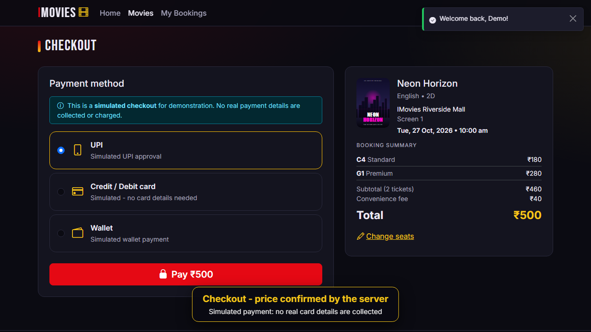 |
| 9. Booking confirmation and digital ticket | 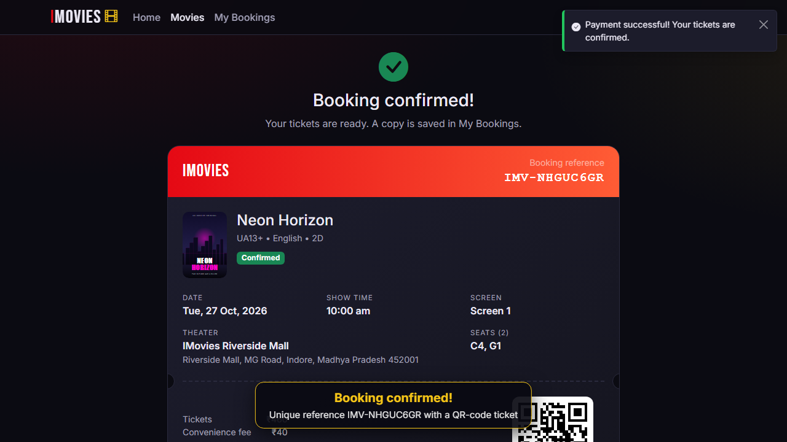 |
| 10. My Bookings | 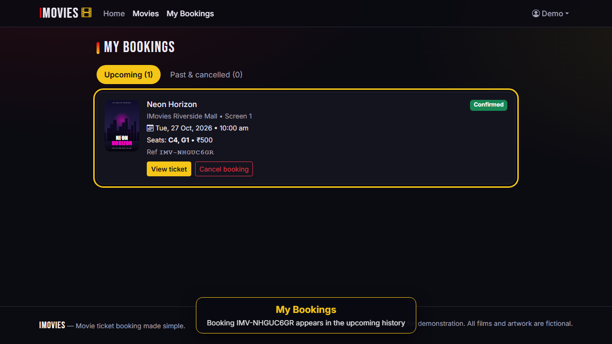 |

### Admin dashboard

| Step | Screenshot |
| --- | --- |
| 11. Overview statistics | 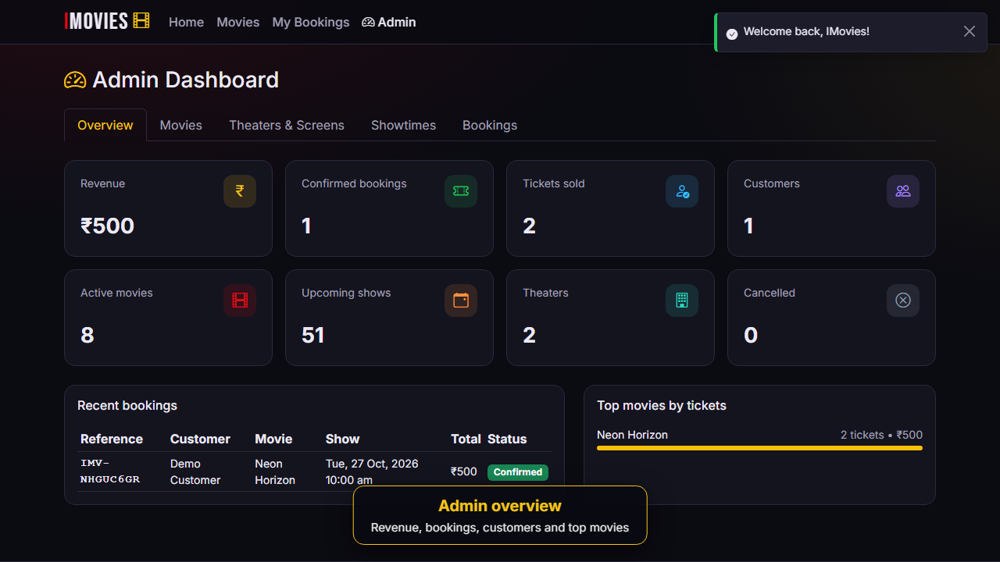 |
| 12. Movie management | 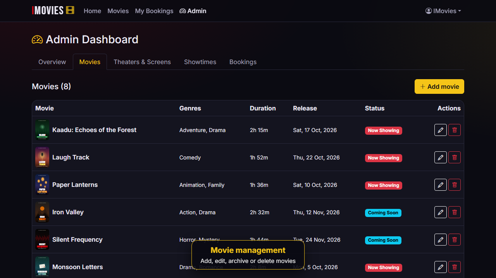 |
| 13. Theaters and screens | 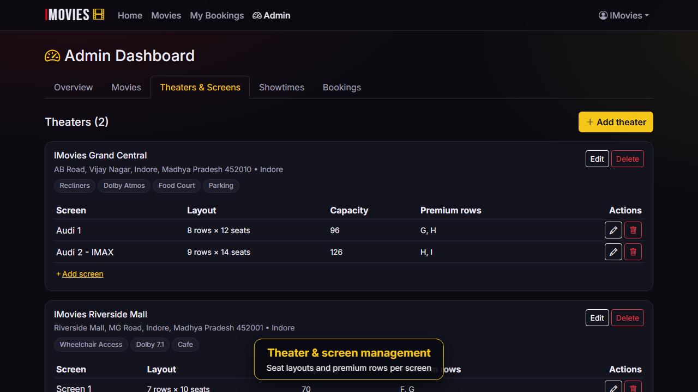 |
| 14. Showtime management | 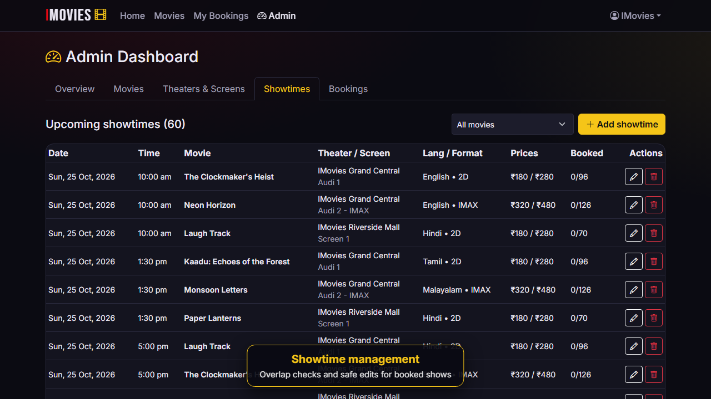 |
| 15. Booking overview | 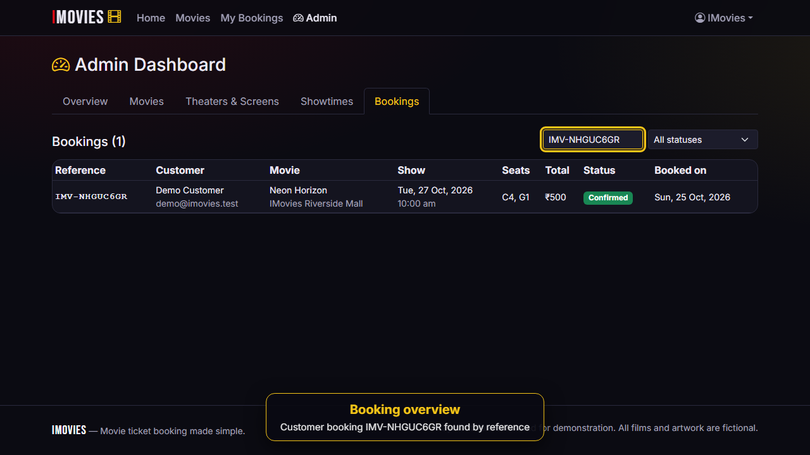 |

---

## 19. Demo Video

- **File in the repository:** [docs/demo/IMovies_Project_Demo.webm](../demo/IMovies_Project_Demo.webm), about 1.5 minutes long, 1280×720, 10.2 MB.
- **Direct link:** <https://github.com/gracie-projects/imovies-movie-ticket-booking-system/blob/main/docs/demo/IMovies_Project_Demo.webm>
- **How to play:** open the link and click **View raw** or **Download**, then play it in Chrome, Edge, Firefox or VLC. On Windows, you can also drag the file into a browser tab.

**What the video shows.** It's a real recording of the running app, driven by Playwright with on-screen captions. Each step is checked automatically before the recording moves on.

1. Home page: Now Showing and Coming Soon.
2. Movie catalog, genre filter, then search by title.
3. Movie details: cast, director, duration and languages.
4. Choosing a date, theater and showtime.
5. Interactive seat map, selecting a standard seat and a premium seat.
6. Live price calculation, including the convenience fee.
7. Redirect to login (a protected route), then login with the demo customer.
8. Checkout with the server-confirmed price and simulated card payment.
9. Booking confirmed: digital ticket with reference and QR code.
10. My Bookings shows the new booking.
11. The seat map now shows those seats as **booked** (double booking prevented).
12. Admin dashboard: overview statistics, movies, theaters and screens, showtimes, and booking search by reference.

**How to re-record it:**

1. From the repository root, start the app with `npm run start:demo`.
2. In a second terminal, from `e2e/`, run `npm run record-demo`.

The new video is saved to `e2e/output/demo/IMovies_Project_Demo.webm`, and the screenshots are refreshed in `screenshots/`.
